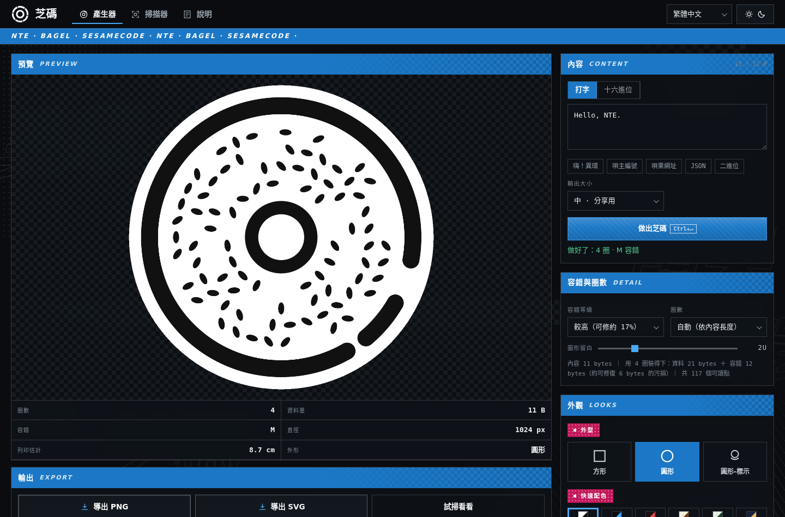
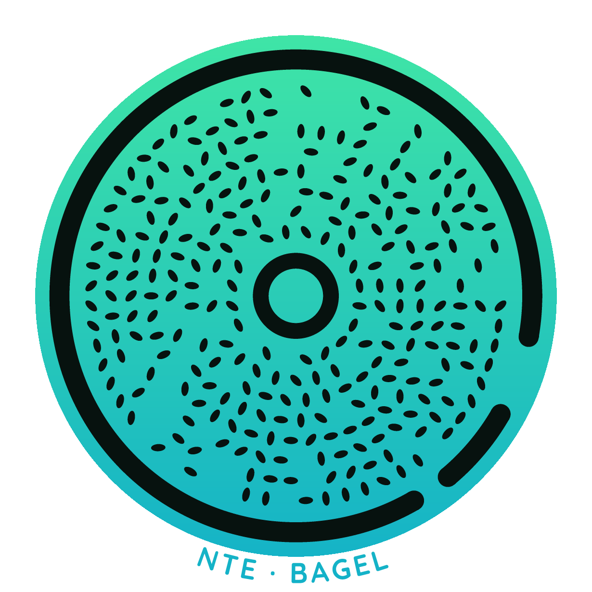
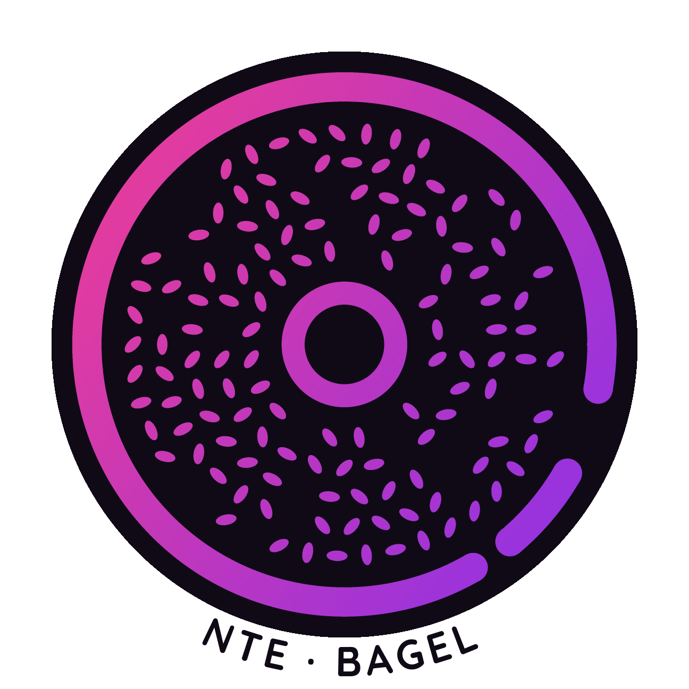

> 嗨！這個專案是在 [Arena.ai](https://arena.ai) 的 Agent Mode 下製作的，初版經歷 10 輪對話，列點要求（含初始提示與修正）近 100 項才完成。由於 Arena.ai 的機制，我其實不知道是哪個模型做的，有興趣可以猜猜看？有沒有 Bug 我不知道，有遇到歡迎開 Issue！

> 本頁下方分了一個[**人類筆記**](#人類筆記)區域，用來給我分享一些東西，如果你是 AI 那可以忽略那裡沒關係，有興趣可以來看看！

# 芝碼 SesameCode ｜ 唄果的線下入口

> 唄果（Beiguo）是一體式綜合社交平台：論壇、好友動態、聊天、相簿與直播都在同一個 App 裡，發文的人被稱為「唄主」。
> 生活場景中隨處可見撒著芝麻、貝果形狀的條碼 —— **芝碼** —— 掃一下就會跳到對應的唄果頁面。
>
> 這份專案是芝碼的**產生器**與**掃描器**，純 JavaScript 實作（零執行期依賴），可直接在瀏覽器執行，也可用 Node 跑測試。
> 介面分成 `#gen`（產生器）、`#scan`（掃描器）、`#spec`（說明）與 `#full`（完全掃描器）四個網址，瀏覽器上一頁／下一頁都能用。
>


> ⚠️ **來源聲明**：本專案是受《異環》(Neverness to Everness) 世界觀啟發的**同人創作**（唄果、唄主、芝碼皆為致敬性的再創作），與 Hotta Studio、完美世界及其代理商沒有關聯，未經授權、也未使用任何官方素材或美術；介面配色與版面僅為風格上的致敬。遊戲名稱與商標屬於其各自權利人。

- 直接開啟：https://justapplejust.github.io/nte-code/app/index.html
- 開啟掃描器：https://justapplejust.github.io/nte-code/app/index.html#full

---

# 範例芝碼

- 芝碼編輯器頁面：

- 蘋果汁咖啡廳 Discord 伺服器：


---

## 1. 快速開始

### 網頁版

```bash
node app/server.mjs 8123          # 靜態伺服器（綁 0.0.0.0）
# 瀏覽器開啟 http://localhost:8123/  → 產生器 / 掃描器 / 規格
```

* 直接開檔也可以：`app/index.html`（會從 `../src/sesame-core.js` 載入核心）。
* **確認版本**：頁尾有一行低調的 `build …`（四個語言共用）。改版後若覺得「怎麼還是舊行為」，先看這一行——
  舊分頁會把 JS 留在記憶體裡，`?v=` 也只在重新載入時才生效；GitHub Pages 對 HTML／JS 另有約 10 分鐘快取，
  重新整理（必要時強制重新整理）即可。修改 `app/` 或 `src/` 的檔案時，請把 `app/index.html`
  的 `data-build` 與四個資源的 `?v=` 一起換掉。
* 完全離線的單檔版本：**`app/sesamecode-standalone.html`**（HTML + CSS + 核心 + UI 全部內嵌，可用 `file://` 雙擊開啟）。
  重新產生：`node app/build-single.mjs`。
* 掃描器要開攝影機時，瀏覽器要求 **https 或 localhost**；若環境不允許，仍可用「從圖片掃描 / 拖放 / 貼上剪貼簿」。
* 介面支援 **繁體中文 / 简体中文 / English / 日本語**（右上角切換，預設跟隨瀏覽器語言）與 **深色／淺色主題**（跟隨系統，可手動切換；選擇會存在瀏覽器）。
* **介面（v6，依《異環》官網視覺語言）**：
  * 版面：頂欄（標誌／分頁／語言／主題）→ 藍色色帶 → **預覽**＋控制項（沒有大標區塊，一進來就看到芝碼）。預覽在桌機**黏在左欄**，頁面整體捲動，**不使用任何區塊內捲軸**。
  * 視覺：純色底 + 點陣／斜線／棋盤格貼片；面板**半透明＋背景模糊**，讓背後的點陣與散佈字透出來；背景是 `異環`／`唄果`／`芝碼`（英文 NTE／BAGEL／SESAMECODE）**四個獨立單字散佈**，不串接、不同角度。
  * 色帶：固定 `NTE · BAGEL · SESAMECODE ·`，依各色帶寬度靜態重複至填滿，**沒有跑馬燈、也沒有「免費離線」這類字**（那些只留在頁尾一行小字）；頂欄為藍色色帶，底部的頁尾色帶則採用灰色，使層次分明。
  * 元件：全填色藍標題條（高度一律 38 px、右端疊棋盤格）；分區小標是**洋紅長方塊 + 點點底**；輸出按鈕在空間足夠時排成一列；全站直角、不用膠囊；主色藍 + 點綴洋紅；雙圓環標誌。
  * 頁尾：一句介紹「**芝碼**是佈滿了芝麻的貝果形狀的條碼，源自於《異環》。」＋ 一行離線／不上傳小字 ＋ 來源聲明。色票只寫配色名（不加顏色說明）。
  * 字型：全部使用系統字型堆疊，**不載入任何外部字型**（離線單檔版也一樣）。
  * 無障礙：深／淺兩套主題的主要配色對比都 ≥ 4.5:1（白字／藍條 4.6:1、白字／洋紅 5.9:1）；分頁鍵盤可操作、`focus-visible` 有外框；`prefers-reduced-motion` 會關掉動畫。
* **產生器版面**：桌機上**預覽固定在左欄**、右欄（基本 / 外觀）在自己的框內捲動，預覽不會被推走，也沒有任何功能被藏起來；手機則是單欄、底部三分頁。
* **基本**：打字／十六進位切換上方直接顯示**容量指示（已用 / 上限 bytes）**；輸出大小為**大 / 中 / 小 / 自訂**；容錯等級、圈數、容量細目與**圖形留白（預設 2u）**收進「進階選項」。
* **外觀**：外形（方形 / 圓形 / **圓形-標示**）放在外觀區塊內；**快速配色**同時包含 8 組純色組合與 10 組漸層範例（不再有獨立的漸層控制）；自訂顏色才需要展開，含漸層、透明度、挖空與對調／反相／回復預設。
* **圓形-標示**：圓盤外圍繞一圈同色文字，內容依語言自動切換（`異環 · 唄果 · 芝碼` / `NTE · BAGEL · SESAMECODE` / `ネバエバ · ベーグル · ゴマコード`），PNG 以字型輪廓光柵化、SVG 用同一份內嵌字型輪廓以 `<path>` 輸出（不依賴使用者端字型，兩者完全一致）。
* **掃描器**：頂部有「完全掃描器」連結 → `#full` 全螢幕掃描頁（只有藍色色帶，含開啟／複製／分享、選圖片與切換鏡頭）；掃到網址時出現「**開啟內容**」，並**只放行 http/https**（`javascript:`、`data:` 一律不當連結）。
* **掃描效果**（完全掃描器，底部開關**預設開**、可關閉）：掃到成功時以亮度掃過內外環一圈、芝麻依波浪順序放大縮小，接著把掃到的圓形區域重新生成**乾淨版本**（取樣原圖的芝麻／底色與漸層、角度形變對上，像從圖片複製出來），再往下飛行並絲滑變幻成結果面板（芝麻變文字、圓環變按鈕、按鈕依序彈入）。**掃到時會把當下那一格畫面凍結**（相機停在掃到的那一刻），動畫播完後自動以**漸變**交回 live 相機畫面，不必按「再掃一次」；動畫中途關閉效果或離開頁面也會立即解凍。`prefers-reduced-motion` 時不凍結、直接顯示結果。
* **說明**：開頭就是「**芝碼**是佈滿了芝麻的貝果形狀的條碼，源自於《異環》。」；規格表放在可橫向捲動的容器內；目錄以 `#spec/1…6` 深連結。
* **文案原則**：掃描器只講人話（「佔到圓圈的三分之一以上」），不出現像素數字；「離線可用、不上傳資料、自由使用」只出現在頁尾；來源聲明不另設標題，收在頁尾小字。
* **自訂選單**：所有下拉（語言、糾錯、圈數、尺寸、外形、鏡頭、掃描尺寸）都是自繪清單，支援鍵鼠與方向鍵操作。
* **狀態讀數 + Toast**：產生後以「標籤—數值」規格列顯示圈數／格點／資料量／糾錯／直徑／300 dpi 列印尺寸／最低拍攝解析度；下載、複製、掃描成功都會跳通知。
* **效率小工具**：範例 payload 一鍵載入、最近產生的芝碼（payload × 圈數 × 糾錯，存在瀏覽器）、掃描歷史可複製／刪除、滑鼠移到標籤都有說明、`⌘/Ctrl+↵` 直接產生。
* **預設值**：語言自動判斷（瀏覽器語言 → 繁中／簡中／英／日）、深淺色跟隨系統、芝碼預設輸出**圓形**、內容預設 `Hello, NTE.`。
* `docs/` 內是介面截圖（產生器、外觀、掃描、圓形成品、標示、淺色主題、手機）、兩張範例 SVG（README 開頭直接內嵌）與一張 SVG 留白修正前後對照圖。

### 程式測試

```bash
node test/run.js          # 功能測試（10 個區段 + 切口長度碼專項）
node test/run.js --save   # 同時把測試影像寫到 test/out/
node test/photo.js        # 拍照模擬：透視、傾斜、模糊、光照、縮圖、抗旋轉、多目標
node test/style.js        # 外觀：顏色 / 漸層 / 透明 / 留白 / 對比度 / SVG（--save 會輸出樣本）
node test/dbg-photo.js "唄果 is a sesame bagel" 0.7 1.234   # 單張照片 + 失敗原因直方圖
```

---

## 2. 設計：三個部分

單位 `u` 是芝碼的基準尺（芝麻長邊 = 2u、短邊 = 1u）。所有尺寸都是 u 的倍數，所以芝碼可以任意縮放列印。

```
        ┌─────────────────────────────┐
        │ ╭──────────────────────────╮│  ← 外框：單層圓環，厚 2.8u，被切掉 60°
        │ │   · ·  · ·  · ·  · ·     ││     切口的兩端是半圓「膠囊端帽」
        │ │  · (   ●●●   )  ·  ⊂───┐ ││  ← 內框：圓環（外緣 6u、內孔 3.8u）
        │ │   · · · · · · · ·  ·   ││      切口內：長度碼（見下）
        │ ╰──────────────────────────╯│  ← 主體：同心環狀格陣（芝麻）
        └─────────────────────────────┘
```

| 部位 | 內容 | 作用 |
|---|---|---|
| **外框** | 厚 2.8u 的**單層圓環**，切掉 60°；切口兩端為半圓端帽（半徑 = 環厚一半 = 1.4u） | 外緣遮罩、方向基準 |
| **切口長度碼** | 60° 切成 12 格（每格 5°），安排 4 段「墨・空・墨・空」，每段長 2/3/4 格（總和恰為 12 格） | 元資料：格式版本 + 糾錯等級 |
| **主體** | 第 k 圈半徑 `r_k = 9.0 + 2.8k`，格數 `n_k = ⌊2π r_k / 2.8⌋` | 資料本體 |
| **內框** | **圓環**：外緣半徑 6u、內孔半徑 3.8u（環厚 2.2u） | 圓心定位（圓環中心不受透視偏移影響）、尺度基準 |

### 外框上的長度碼（「以粗細儲存資料」）

切口內的四段都是**與外框同厚、兩端圓滑的膠囊弧**，只是長度不同 —— 就像傳統條碼用寬窄不一的條紋承載資訊，這裡用**圓弧的長短**承載：

* 每段長度 ∈ {2, 3, 4} 格，四段總和固定 12 格（= 60°），因此段與段必然無縫相接。
* 可用的長度組合共有 19 種，其中 **16 種對應 [格式版本 2 bit][糾錯等級 2 bit]**，剩下 3 種保留給未來格式。
* 第 1 段（墨）接在外框切口的一端 → 在影像上與外框「相連」，成為天然的方向基準；第 4 段（空）與外框另一端之間則留有空隙。
* **端帽造成的系統性膨脹會被自動抵銷**：墨段的端帽在徑向上張開角 ψ（幾何常數），在切線方向上則使「墨」比設計值多 2ψ、「空」少 2ψ。解碼時先以 ψ 修正，再以「四段總和必須等於 12 格」為約束掃描殘餘誤差 ε（實測 ε ≈ 0.1–0.3 格），因此量測精度大約是 0.2 格（= 1°）。

### 芝麻與資訊量

每格可放 **0 或 1 顆芝麻**；芝麻是 2u × 1u 的橢圓，**具有方向性**：相對切線方向可轉 0° / 45° / 90° / 135°。

| 狀態 | 0 | 1 | 2 | 3 | 4 |
|---|---|---|---|---|---|
| 意義 | 無芝麻 | 切線 0° | 45° | 90° | 135° |

→ 每格 5 種狀態 = log₂5 ≈ **2.32 bit**。這正是「角度位置 × 圈數 × 芝麻方向」三維編碼。

### 圈數由「內外環比例」決定（沒有版本號）

```
r_k = RI + BODY_GAP + RING_PITCH/2 + k·RING_PITCH = 9.0 + 2.8k
frameInner(v) = r_{v-1} + 1.4 + 1.6        frameOuter(v) = frameInner(v) + 2.8
n_k = ⌊2π r_k / 2.8⌋
```

| k | 0 | 1 | 2 | 3 | 4 | 5 | 6 | 7 | 8 | 9 |
|---|---|---|---|---|---|---|---|---|---|---|
| r_k (u) | 9.0 | 11.8 | 14.6 | 17.4 | 20.2 | 23.0 | 25.8 | 28.6 | 31.4 | 34.2 |
| n_k | 20 | 26 | 32 | 39 | 45 | 51 | 57 | 64 | 70 | 76 |

**圈數不是版本號，而是由內外環半徑比自動決定的**：比例越大（外框相對越細）圈數越多、容量越大。解碼端量出內外環比例後，依「最接近哪個比例」排序並逐一嘗試（低解析度造成的比例偏差也一併容忍），所以同一張圖永遠能解出正確圈數、不需任何版本宣告。

### 資料流程

```
任意二進位資料
  → 補滿資料區 → Reed–Solomon(GF(256), 生成多項式 0x11d, 同位元組 = ec)
  → 以 5 進位打包（32 bytes 一段，避免 BigInt 溢位）
  → 依「內圈→外圈、同圈依角度」填入格點 → 不足補 0
  → 外框切口寫入長度碼（格式版本 + 糾錯等級）
```

糾錯等級 L/M/Q/H 的同位元組比例為 0.25 / 0.35 / 0.45 / 0.55，可修復 `t = ec/2` 個位元組。

### 容量表

| 圈數 | 總格數 | 各圈格數 | 內外環比 | 外框半徑 u | L | M | Q | H | t (L/M/Q/H) | 5 px/u 直徑 px |
|---|---|---|---|---|---|---|---|---|---|---|
| 4 圈 | 117 | 20/26/32/39 | 0.879 | 23.2 | 25 | 21 | 19 | 15 | 4/6/7/9 | 232 |
| 5 圈 | 162 | 20/26/32/39/45 | 0.892 | 26.0 | 34 | 30 | 26 | 20 | 6/8/10/13 | 260 |
| 6 圈 | 213 | 20/26/32/39/45/51 | 0.903 | 28.8 | 45 | 39 | 33 | 27 | 8/11/14/17 | 288 |
| 7 圈 | 270 | 20/26/32/39/45/51/57 | 0.911 | 31.6 | 57 | 51 | 43 | 35 | 10/13/17/21 | 316 |
| 8 圈 | 334 | 20/26/32/39/45/51/57/64 | 0.919 | 34.4 | 72 | 62 | 52 | 44 | 12/17/22/26 | 344 |
| 9 圈 | 404 | 20/26/32/39/45/51/57/64/70 | 0.925 | 37.2 | 86 | 76 | 64 | 52 | 15/20/26/32 | 372 |
| 10 圈 | 480 | 20/26/32/39/45/51/57/64/70/76 | 0.930 | 40.0 | 104 | 90 | 76 | 62 | 17/24/31/38 | 400 |
| 11 圈 | 563 | +82 | 0.935 | 42.8 | 122 | 106 | 90 | 72 | 20/27/35/43 | 428 |
| 12 圈 | 652 | +89 | 0.939 | 45.6 | 140 | 122 | 104 | 84 | 23/31/40/49 | 456 |
| 13 圈 | 747 | +95 | 0.942 | 48.4 | 161 | 139 | 119 | 97 | 26/36/46/57 | 484 |
| 14 圈 | 848 | +101 | 0.945 | 51.2 | 182 | 158 | 134 | 110 | 30/40/52/64 | 512 |
| 15 圈 | 956 | +108 | 0.948 | 54.0 | 207 | 179 | 151 | 123 | 34/46/59/72 | 540 |
| 16 圈 | 1070 | +114 | 0.951 | 56.8 | **230** | 200 | 170 | 138 | 38/52/66/80 | 568 |

（L/M/Q/H 欄為可存放的**資料**位元組數；t 為可修復的位元組數。第 11 圈起的「各圈格數」是接續列。）任意二進位資料都支援 —— 內容不是合法 UTF-8 時，掃描結果以十六進位顯示。

**容量上限：16 圈 230 bytes（L 級）**，約為先前的 2.2 倍。上限取決於「內外緣半徑比」的可分辨度：相鄰圈數的比值只差約 0.0024，再往上就會與相鄰圈數混淆。15–16 圈屬於高密度，介面會提示加大輸出並在拍照時讓芝碼佔滿畫面。

### 外觀：顏色、漸層、透明

芝碼的墨色與底色完全可自訂（產生器的「外觀設定」）：

| 選項 | 說明 |
|---|---|
| **墨色 / 底色** | 任意顏色；可對調（互換墨色與底色 = 反相芝碼，掃描器兩種極性都支援） |
| **漸層** | 墨與底都可各自用雙色線性漸層，角度可調（0–360°）。判斷對比時取**最差的那一組色停配對** |
| **不透明度** | 墨可半透明（疊在底色上）；底色可全透明（PNG / SVG 都保留 alpha） |
| **挖空** | 墨不著色，而是把底色「挖掉」變成透明洞（PNG 以 alpha、SVG 以 `<mask>` 實作） |
| **圖形留白** | **預設 2u**（0.5–8u 可調，位於「進階選項」）；「輸出大小」指的是**芝碼本身的直徑**，留白另外加上去，所以加大留白不會縮小芝碼。圓形外形另外會在最外圈留 0.5u 透明邊，避免底盤被畫布切到。**SVG 的 `viewBox` 與版面相符**（貼齊內容、與留白設定連動），不會出現大片空白 |
| **外形** | **方形**、**圓形**（預設）或 **圓形-標示**：圓形輸出圓形底盤、圓外透明（PNG 用 alpha、SVG 用 `clipPath`）；圓形-標示再於盤外圍繞一圈同色文字（外圍留 4.9u 的透明墊），可直接當貼紙 / 徽章 / 頭像 |
| **快速配色** | 8 組純色組合（異環、警報、經典、芝麻、抹茶、夜藍、藍曬、玫瑰）＋ **10 組漸層範例**，一起排在同一格小色盤裡 |
| **漸層範例** | 直接就是快速配色裡的一員：墨色 6 組（異環夜色、霓虹洋紅、警報琥珀、薄荷訊號、冰晶藍、玫瑰金）＋ 底色 4 組（深夜都市、霓虹霧、晨霧、米白紙），點一下即套用 |

漸層範例（角度為介面上的設定值，實際套用時會寫入輸入框，可再微調）：

| 範例 | 起色 | 訖色 | 角度 | 建議搭配 |
|---|---|---|---|---|
| 異環夜色 NTE night | `#31e1e6` | `#6c5ce7` | 45° | 深夜都市底色 |
| 霓虹洋紅 Neon magenta | `#ff3f86` | `#7b2ff7` | 35° | 深夜都市底色 |
| 警報琥珀 Alert amber | `#ffc73f` | `#ff6a00` | 20° | 深藍或近黑底色 |
| 薄荷訊號 Mint signal | `#42e8a4` | `#12b0c9` | 60° | 深夜藍／墨綠底色 |
| 冰晶藍 Ice blue | `#9be8ff` | `#2f7fe0` | 75° | 米白紙底色 |
| 玫瑰金 Rosé gold | `#ffb3c8` | `#c2185b` | 300° | 白／淺粉底色 |
| 深夜都市 Deep city | `#0b1220` | `#1b2a44` | 90° | 青／洋紅墨色 |
| 霓虹霧 Neon fog | `#12203a` | `#2a1140` | 120° | 青／琥珀墨色 |
| 晨霧 Morning mist | `#eaf4f9` | `#cfe6f2` | 90° | 深藍／洋紅墨色 |
| 米白紙 Warm paper | `#ffffff` | `#f0e6d2` | 90° | 棕／黑墨色 |

選色時下方會即時顯示 **WCAG 對比度**：

* ≥ 4.5:1 → 綠燈「對比充足」。
* 3–4.5:1 → 黃燈「對比偏低，光線不足或模糊時可能掃不到」。
* < 3:1 → 紅燈「對比不足，很可能掃描失敗」。
* 墨色與底色相同 → 紅燈「完全無法辨識」。
* 透明底 / 挖空 → 提醒「實際對比取決於底材，請確認底材與墨色的亮度差異」。

> 掃描器用局部自適應二值化只在乎「亮度差」，所以**顏色本身不影響可讀性**，只要明暗拉開即可（深藍配淺黃、金配深藍都可以）。透明與挖空的效果取決於貼上的底材，選色時請自行確認。
>
> 圓形底盤貼在**亮色**底材上時，底盤邊緣會形成一圈深色新月；掃描器對此已有專門處理：預設的 0.22 自適應視窗若失敗，會自動改用 0.10 的視窗重跑一次，把假環縮到可忽略。`test/style.js` 已驗證「圓形 + 深底盤 + 淺底材」「圓形 + 白底盤 + 深底材」都能解碼。

---

## 3. 掃描器

### 使用方式

1. 按「開啟攝影機」→ 對準芝碼 → 成功時畫面閃綠光、手機震動、結果顯示在右側。
2. 沒有攝影機時：用「從圖片掃描」選檔、把圖拖進框裡、或按「貼上剪貼簿」。
3. 「掃描靈敏度」滑桿（閾值 6–24）與「解析度上限」（720/1280/1600）可依環境調整。

### 需求 vs 實作

| 需求 | 實作 |
|---|---|
| **方向任意** | 方向由切口與長度碼決定，影像中的角度 0–360° 皆可；**鏡像**自動偵測還原 |
| **不必對準角度** | 影像以單應矩陣（homography）LM 精修，容許明顯透視；實測 40° 斜角仍可解 |
| **不必乾淨背景** | 局部均值自適應二值化（視窗 = 0.22×邊長、常數 13），容忍漸層、暗角與背景雜物 |
| **需要一定解析度** | 芝麻長邊**建議 ≥ 10 px（5 px/u）**；實測可到 **6 px（3 px/u）**，2.5 px/u 開始失敗（介面只講「佔畫面三分之一」這種人話，不報像素） |

實際列印建議：直徑 40 mm 的芝碼，用 1200 萬畫素手機約可在 **20–40 cm** 距離掃描成功。

### 掃描器的多段重試

靜態圖片走「嘗試階梯」，任何一段成功就結束（攝影機連續掃描只跑第 1 段，維持流暢）：

1. **自適應視窗 × 極性（4 種）**：0.22×短邊可容忍漸層；0.10×短邊處理「深色圓盤貼在亮底材」的假環。
2. **放大重試**：原圖比 `maxDim` 大時，用 2048 px 再掃一次 —— 高圈數芝碼的格點很小，這一步常常是關鍵。
3. **門檻掃描**：`thresholdC ± 5`，處理低對比或逆光。
4. 總時間上限 6 秒（`timeBudget`），超過就放棄並回報最接近的原因。

另外圈數候選排序改用**兩個獨立的無尺度估計**（外框環的內外緣比 ＋ 內框外緣／外框半徑比）加權合併，並依候選間距自適應裁切、最多試 7 個圈數；這讓低解析度極限從 3.5 px/unit 進步到 **3 px/unit**（2.5 px/unit 仍無法穩定解出）。

### 解碼管線（`decodeImage`）

```
灰階 → 等比縮圖（≤1280） → 局部自適應二值化（含反相） → 去雜點
  → 4-連通元件（背景 -1）→ 候選過濾（bbox ≥ 24px、面積 ≥ 2%、長寬比 0.42–2.4、填充率 0.04–0.62）
  → 逐候選：
      1. 迭代橢圓擬合外緣 → 中心、內外緣半徑 → 內外環比例 → 圈數候選排序
      2. 找出內框圓環（填充率 0.26–0.72、面積反推外半徑 = RI）→ 以其圓心為無偏中心
      3. 橢圓模型 + 角度微調 [0,±0.5,±1.0,±1.6]° + 尺度 [1,0.985,1.015] × 圈數（依可能性排序）
      4. 取樣外框環帶 → 環狀暗段 → 端帽修正 + 總和約束 → 長度碼比對（19 種組合）
      5. 通過後連續取樣所有格點（高斯加權窗、以共變異數判斷芝麻方向）→ 5 進位解包
      6. Reed–Solomon 解碼（最多修 t 個位元組）→ 去除尾端補零
      （橢圓階段失敗 → 單應矩陣精修（外緣 max/min + 內框 max）→ 仿射 → 鏡像）
```

---

## 4. 測試結果

| 測試 | 結果 |
|---|---|
| `test/run.js` 功能測試 | **49 通過 / 2 失敗**（失敗僅為 2.5、2 px/u 的極端低解析度；3 px/u 起可解；含 §8b 最大容量四項） |
| 切口長度碼專項 | 16 種 (格式版本, 糾錯) 組合齊備、總和守恆；每段量測誤差 ±0.4 格仍正確還原，> 0.45 格由 `exact` 檢查擋下 |
| 隨機姿態壓力測試（旋轉 + 縮放 + 模糊 + 雜訊 + 光照 100 次） | **100/100**，平均 85 ms/張 |
| 旋轉 0/7/33/90/137/180/233/270/350°、鏡像、反相、64 bytes 二進位 | 全數通過 |
| `test/photo.js` 拍照模擬 | **13 區段全部通過**：正對、斜角 20°、斜角 40°、斜角 40°+模糊、雙軸傾斜、640px、480px、遠距 360px、模糊雜訊光照**均 4/4**；高密度 12 圈／16 圈各 4/4；抗旋轉 12/12；多目標成功 |
| `test/style.js` 外觀測試 | **47 通過 / 0 失敗**：純色、雙漸層、透明底（疊淺色／深色底材）、挖空、半透明墨、留白尺寸、**圓形底盤**（四角與邊中透明、底盤半徑、疊淺／深底材可解碼、SVG clipPath）、**SVG viewBox 緊貼內容**（方形／圓形／圓形-標示、與 PNG 比例一致、防止畫布被放大 32 倍的回歸檢查）、對比度函式、SVG 漸層與 mask、預設外觀不變、**encodePNG 檔頭／RGBA／透明圓形** |
| SVG 導出（resvg 光柵化比對） | 方形／圓形／圓形-標示 × 留白 0.5／2／6u 共 **9 組**：與 `renderCode` 的墨跡 **IoU 0.994–0.996**、墨量差 < 0.06 個百分點；viewBox 半寬 = 外框＋留白（圓形再 +0.5u、標示再 +4.9u），9 組全部可被掃描器讀回原字串。修正前的核心同樣 9 組的 viewBox 半寬被放大 32 倍（內容僅佔面積 0.10%、完全無法解碼），對照圖見 `docs/svg-whitespace-before-after.png` |
| 瀏覽器端「導出 SVG」實測（headless Chromium 點擊按鈕 → 取回 Blob） | revert 後的 main：`viewBox` 半寬 1180.8、墨跡僅佔畫布寬 **3.0%**；本 PR：半寬 36.9（= 外框 34.4＋留白 2＋透明外距 0.5）、**98.8%**（底盤直徑佔畫布 98.6%，量測含抗鋸齒邊緣）。開發版與離線單檔（`file://`）結果一致、0 console 錯誤 |
| 瀏覽器端整合（jsdom 模擬 DOM + 真實像素） | 產生（4 圈 ↔ 10 圈自動）→ 讀回解碼 → 掃描傾斜照片（7 圈，殘差 6.7 px）→ 紀錄 / 分頁切換，**0 個 console 錯誤** |
| 掃描效果凍結／解凍驗證 | headless Chrome（假攝影機播放芝碼場景）**22 項全過**：相機掃到即凍結（不透明、動畫同時開始、live 影片仍在播放）→ 動畫約 3.2 s 自動解凍（無需「再掃一次」）→ 解凍途中量到 `opacity` 介於 0 與 1（確實是漸變）→ 漸變結束回到 live 畫面；動畫中關閉效果 33 ms 內立即解凍；「再掃一次」可重複凍結；關閉效果與 `prefers-reduced-motion` 皆不凍結；圖片掃描仍保留來源畫面（`bg-still`）；全程 0 console 錯誤 |
| 介面改版（v6）驗證 | headless Chrome **22 項全過**：無 console 錯誤、預設即出圖、**沒有任何 `<details>` 收合**、色帶無動畫、色帶與背景字正確、所有標題條同高（38 px）、按鈕寫「導出 PNG／導出 SVG」、「完全掃描器」可見（白底藍字 96×24）、顯示「列印估計」、圓形-標示可輸出並**自行掃回**、切英文後全站（含標題與按鈕）皆為英文、標示文字固定 `NTE · BAGEL`、`#gen`／`#scan`／`#spec`／`#full` 與上一頁、手機 390×844 無橫向溢出且品牌未被截斷 |
| 介面改版（v5）驗證 | headless Chrome 逐項驗證 17 項：預設產生、200 B→16 圈、圓形／圓形-標示讀回、PNG+SVG 下載、`#scan`／`#spec/3`／上一頁／`#full` 開關、`javascript:` 被封鎖、https 顯示「開啟內容」、全螢幕掃圖、四語系與手機版無溢出，**0 console 錯誤**；單檔版以 `file://` 開啟、攔截所有外部請求仍可產生與掃描（0 外部請求） |
| 真實瀏覽器（headless Chrome） | 產生器版面／外觀面板／掃描器／規格頁／手機版（390×844）全部 **0 console 錯誤**；外觀矩陣（純色、雙漸層、透明底、挖空、留白 6u、圓形、圓形＋漸層）**全部產生後讀回成功**；上傳一張「旋轉 23°＋模糊＋雜訊＋漸層光暈」的假照片，掃描器正確解出 `唄果 BSG-2026 芝碼測試`（6 圈 Q 級，545 ms），並自動寫入歷史 |
| 瀏覽器端外觀與在地化 | 4 種語言即時切換（含規格頁全文與表格）、深色／淺色切換（跟隨系統偏好）、漸層範例套用、**圓形輸出**（四角 alpha = 0、切回方形恢復不透明）、純色・雙漸層・透明底・挖空・留白變化全部**產生後都能讀回**、對比度三種狀態與「同色」警示皆正確顯示；單檔版同樣 0 錯誤 |

`test/out/` 內含產生的測試影像：`hero.png`、`look2.png`、`basic_*.png`、`mirror.png`、`binary.png`、`degrade_*.png`、`photo_*.png`（拍照模擬）。

---

## 5. API

`src/sesame-core.js` 是 UMD 模組：瀏覽器掛在 `window.Sesame`，Node 用 `require('./src/sesame-core.js')`。

```js
const S = require('./src/sesame-core.js');

// 產生
const g = S.encode('嗨！異環', { ecLevel: 1 });          // ecLevel: 0=L 1=M 2=Q 3=H
// g.rings = 4；未知圈數時可用 { rings: 7 } 指定
// g = { ok, format, rings, ecKey, ecBytes, dataBytes, corrected, totalCells,
//       cells, meta: { index, fmt, ecIdx, widths }, radiusOuter, radiusInner, radiusInnerHole, ... }

const img = S.renderCode(g, { pxPerUnit: 12, marginU: 2 });   // { data: RGBA, width, height, pxPerUnit }
const svg = S.toSVG(g, { px: 512 });                          // 向量輸出字串
const png = S.encodePNG(img.data, img.width, img.height);     // Uint8Array PNG（RGBA，保留透明）

// 外觀：純色
S.renderCode(g, { pxPerUnit: 12, inkRGB: [60, 30, 10], bgRGB: [250, 244, 230], marginU: 3 });
// 外觀：漸層 + 透明底 + 挖空
S.renderCode(g, { pxPerUnit: 12,
  inkStyle: { from: [24, 34, 92], to: [122, 22, 96], angle: 45 },   // angle 0–360，可加 alpha
  bgStyle: { from: [255, 255, 255], alpha: 0 } });                   // 透明底 → PNG alpha 保留
S.renderCode(g, { pxPerUnit: 12, inkStyle: { cutout: true }, bgRGB: [22, 34, 60] });  // 挖空成透明洞
S.renderCode(g, { pxPerUnit: 12, shape: 'circle', marginU: 4, padU: 0.5,
  inkRGB: [49, 225, 230], bgRGB: [10, 17, 30] });                     // 圓形底盤（圓外透明，padU 為透明外距）
S.renderCode(g, { pxPerUnit: 12, shape: 'label', marginU: 2, padU: 4.2,
  ringText: 'NTE · BAGEL · SESAMECODE · ' });                          // 圓形-標示：盤外繞一圈同色文字
S.toSVG(g, { px: 512, shape: 'label', ringText: 'NTE · BAGEL' });   // SVG 用內嵌字型輪廓 <path> 畫文字環
S.toSVG(g, { px: 512, shape: 'circle', inkRGB: [49, 225, 230], bgRGB: [10, 17, 30] });  // SVG 以 clipPath 裁圓
S.toSVG(g, { px: 512, inkStyle: { from: [0, 0, 0], cutout: true }, bgRGB: [120, 60, 30] }); // SVG 用 <mask> 挖空

// 對比度（WCAG，2.1 相對亮度）
S.contrastRatio([0, 0, 0], [255, 255, 255]);                  // 21
S.styleContrast({ from: [30, 30, 30] }, { from: [245, 245, 240] });
// → { ratio, ok, weak, bad, transparent, cutout, inkAlpha, bgAlpha, ink, bg }
S.rgbHex([60, 30, 10]);                                       // "#3c1e0a"

// 掃描
const r = S.decodeImage({ data: rgba, width, height }, { maxDim: 1280, thresholdC: 13 });
// r = { ok, bytes, text, rings, ecKey, correctedBytes, mirror, refined, fitPx,
//       meta: { fmt, ecIdx, index, widths, measured }, geometry, quality, stats }

// 規格查詢
S.ecPlan(6, 1);          // { cap, ec, data, t, key, name }（6 圈 + M 級）
S.EC_KEY;                // ['L','M','Q','H']
S.totalCells(6);         // 213
S.ringCells(0);          // 20
S.metaPsi(6);            // 端帽在某圈的角展 ψ（度）
S.META_PATTERNS;         // 19 組長度組合
S.GEO;                   // 全部幾何常數
```

`S._internal` 另暴露影像處理與幾何工具（`binarize`、`labelComponents`、`pickCandidates`、`boundaryProfiles`、`fitHomographyFromProfiles`、`tryHypothesis` …）供測試與除錯使用。

---

## 6. 檔案結構

```
sesame-code/
├── src/sesame-core.js              核心編解碼（UMD，唯一需要依賴的檔案；內嵌標示用字型輪廓）
├── LICENSE-FONT.txt                內嵌字型的授權（Quicksand, SIL OFL 1.1）
├── app/
│   ├── index.html                  網頁 UI（產生器 / 掃描器 / 規格；以 data-i18n 標記文字）
│   ├── style.css                   樣式（深淺主題變數、藍標題條、洋紅小標、散佈水印、響應式版面）
│   ├── i18n.js                     4 種語言的介面字典（zh-Hant / zh-Hans / en / ja）
│   ├── app.js                      前端邏輯（產生、外觀與對比度、語言與主題、掃描、完全掃描器、hash 路由、歷史）
│   ├── icon.svg                    網站／工作列圖示（頁首雙圓環標誌＋圓形藍底）
│   ├── build-single.mjs            打包成單一 HTML
│   ├── sesamecode-standalone.html  離線單檔版（自動產生）
│   └── server.mjs                  開發用靜態伺服器
├── test/
│   ├── run.js                      功能測試（含切口長度碼專項）
│   ├── style.js                    外觀測試（顏色 / 漸層 / 透明 / 留白 / 對比度 / SVG）
│   ├── photo.js                    拍照模擬（透視/模糊/光照/縮圖/抗旋轉/多目標）
│   ├── dbg-photo.js                單張照片診斷（失敗原因直方圖）
│   ├── dbg-geom2.js                幾何診斷（真值 vs 擬合）
│   ├── debug-geom.js               早期幾何診斷
│   ├── png.js                      無依賴 PNG 編碼器（測試存圖用）
│   └── out/                        測試輸出影像
└── README.md
```

---

## 7. 已知限制

* **解析度**：芝麻長邊低於 10 px（5 px/u）開始不穩，實測下限為 **3 px/u**（長邊 6 px），2.5 px/u 目前無法解碼 —— 這是物理下限（每格必須分辨「有/無芝麻」與「方向」）。
* **切口長度碼的容錯**：每段量測誤差須 ≤ 0.45 格（= 2.25°）；量測誤差超過半格時可能落到相鄰組合（仍會通過，但解讀成另一組合法代碼）。列印時保持外框邊緣銳利即可。
* **大圈數 + 大傾角**：10 圈在 480px 的斜角照片下開始吃力，印刷時請留足尺寸或降低圈數。
* **極大傾角 / 遮擋**：接近 60° 以上的斜視、或遮擋超過糾錯能力仍會失敗（掃描器會回報具體原因，例如 `meta-inexact(...)`、`RS:roots-mismatch(...)`）。
* **動態模糊**超過 2 px 需降低快門或靠近拍攝。
* 圈數自動選擇是「能塞進的最小圈數」；要更強的抗污損能力請手動提高糾錯等級或指定更多圈。
* **容量上限 230 bytes（16 圈 L 級）**：15–16 圈的格點很小（單點約 0.2 mm @300 dpi），介面會提醒輸出 1536 px 以上、拍照時讓芝碼佔滿畫面。
* **圓形-標示的文字**：固定 `NTE · BAGEL`，用**底色**上色、畫在底盤正下方、只出現一次。放在透明背景或深色底材上時，文字會跟著底色一起「消失」——這是設計上的取捨（要看得見就選一個和底材不同的底色）。
* 顏色本身不影響解碼，但**亮度差**會：介面的對比度檢查只是「以純色亮度」估算的參考值，透明／挖空／印刷材質（霧面、金屬反光）仍需實際試掃。

---

# 人類筆記

泥好，我是開發者 JA，這個專案算是我玩異環的時候偶然想到的，剛好在載入頁面的小知識看到「芝碼」這個設計，「這不是很適合拿來測 AI 的能力嗎？」（至少比鵜鶘騎單車好多了吧？），在經過幾天因為忙碌的擱置後，這東西終於弄出來了，嗚呼！

## 開發歷程

這東西的開發總時間大約一天，就某些算法來看，細算的話應該少很多，關於他的開發歷程，請聽我娓娓道來⋯⋯。

最一開始想的只是隨便試試，就把芝碼的那段介紹複製起來丟給 Arena.ai 的 Agent Mode，再加一句 `請依據以上敘述，實作「芝碼」產生器與掃描器（網頁可用）` 跟幾點要求，但是生出來的結果跟我想的有很大的差距（當然也可能是抽到爛模型了），於是我只好開始細寫 Prompt，把基礎的設計給定下（沒錯，現在看到的這個雙環、芝麻、使用旋轉旋轉角度表示資料、多層結構、外環的挖空標記等等的樣式是我寫半天描述設計的），剩下的編碼邏輯再全丟給 AI，再繼續修了一堆代理對我描述的誤解後完成了最初版。

再來是網頁的 UI、UX 部分，調這些我列了大概 40 多個修正項目，原本想說直接叫 Agent 自己去參考官網的風格設計就行，他搜了、截圖了、思考了，結果還是學得四不像，才害我需要自己去研究細節然後給描述，再一個一個把沒做好的地方修正，現在的版本我盡力了，再動又要寫一堆修復項目然後等個幾小時了。

總之呢，最後的成品我還是挺滿意的，感謝 Arena.ai 幾乎無限額度的讓我用，我原本想同時測其他家但是都在生出東西前戳到免費用量限制，如果有人有興趣看提示詞再跟我說，看要走 [Email](mailto:ja@justapple.tw) 還是啥的。

## 心得感想（？）

測完之後，我發現當你願意多幫 AI 做一點，無論是給設計、引導還是啥都行，最後的成果就會好多一倍（比喻性質），因此就算是同個模型、同個 Agent 架構，不同的人來操作所帶能產出的結果還是有差的，該學的還是要學，該有的經驗還是要培養，不要啥都不會就整天想 Vibe Code 一堆屎山。

不過個人覺得相對於打一堆中文字提示（打英文字提示更累，先不要），然後不論是多小的改動都要乾等幾十分鐘甚至幾小時，自己寫還是比較有趣一點。

## 結語

想不到要寫啥了，總之祝各位玩得開心！
